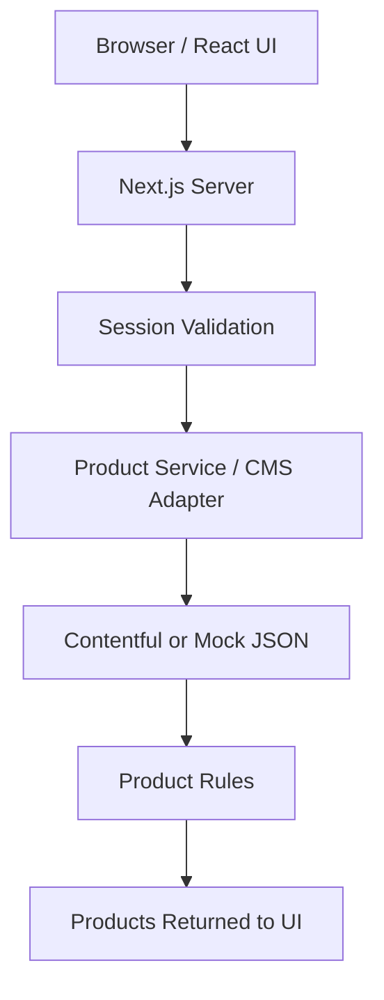
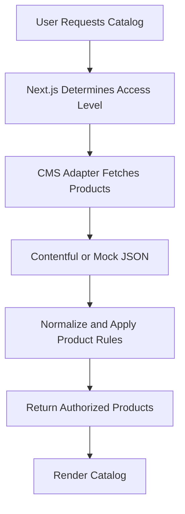
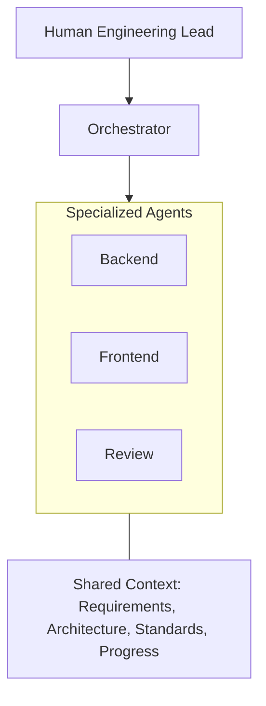

# SIGNAL — Architecture & AI Development Workflow

> **Stack:** Next.js App Router · React · TypeScript · Tailwind CSS · Contentful / mock JSON · Vercel

## 1. At a glance

SIGNAL is a product catalog built with a documented, multi-agent development workflow. The application uses **server-side product access and pricing rules**, while a CMS adapter keeps the UI independent of the content source.

The development workflow documents **how the application was built**: planning, task delegation, specialized agent instructions, review, and verification.

## 2. Application Architecture

SIGNAL uses Next.js App Router with server-side session validation, product access rules, and a CMS adapter that supports both Contentful and mock JSON.

### Key Responsibilities

- **Browser / React UI:** Displays the catalog, search filters, product details, and login interface.
- **Next.js Server:** Handles server-side rendering, session validation, and product requests.
- **Session Validation:** Determines whether the visitor is public or authenticated.
- **Product Service / CMS Adapter:** Retrieves product data from Contentful or mock JSON, depending on configuration.
- **Product Rules:** Applies visibility restrictions, pricing, and search/category filters.
- **Products Returned to UI:** Only the products and prices appropriate for the user's access level are returned.

### Product access

Counts below describe the checked-in mock catalog; Contentful counts depend on published entries.

| Visitor | Visible products | Pricing |
|---|---|---|
| Public | 8 public products | Public price |
| Signed in | All 12 products | Authenticated price |

SIGNAL uses **simulated login** (nonempty credentials). SIGNAL establishes a signed, HttpOnly session cookie and uses server-side access checks. This is not intended to be a production identity system.

## 3. Product Data Flow

Product retrieval happens on the server. The application determines the user's access level before fetching and processing product data.

### Key Steps

1. **Request:** The user opens the catalog or an individual product.
2. **Session:** Next.js validates the session and determines public or authenticated access.
3. **CMS:** The adapter retrieves product data from Contentful or mock JSON.
4. **Business Rules:** The server normalizes products and applies visibility, pricing, and search/category filters.
5. **Response:** Only authorized product information is rendered.

The same server-side access rules apply to **individual product detail requests**, not just catalog listings.

### Contentful integration

The Contentful adapter uses the **Content Delivery API** and resolves linked product assets. The source is selected using `CMS_SOURCE=mock` or `CMS_SOURCE=contentful`. Contentful data is cached with a 60-second revalidation interval; mock mode provides a deterministic local/test source. Contentful failures do not automatically switch to mock data.

## 4. Multi-Agent Development Architecture

The development process separates human oversight, AI coordination, specialized responsibilities, and shared project knowledge.

### Responsibilities

| Location | Responsibility |
|---|---|
| `AGENTS.md` | Global development instructions |
| `agents/orchestrator.md` | Planning, delegation, and coordination |
| `agents/backend-agent.md` | Server logic, CMS integration, and product rules |
| `agents/frontend-agent.md` | UI components and user interactions |
| `agents/review-agent.md` | Independent review and verification |
| `context/` | Shared requirements, architecture, standards, UI direction, and progress |

**Agents define responsibilities; context provides shared project knowledge.** The Human Engineering Lead owns architectural decisions and final approval.

### Development loop

**Plan → Review plan → Delegate bounded task → Implement → Verify → Update progress → Repeat**

Tasks were framed with a clear owner, relevant context, constraints, and acceptance criteria. Review findings informed subsequent iterations.

## 5. Key implementation locations

| File / directory | Why it matters |
|---|---|
| `types/product.ts` | Shared product data contract |
| `data/products.json` | Mock CMS source |
| `lib/cms/products.ts` | CMS source selection and product service interface |
| `lib/cms/contentful.ts` | Contentful API integration |
| `lib/products/product-rules.ts` | Normalization, filtering, and safe pricing projection |
| `lib/auth/` | Simulated session handling |
| `app/catalog/` | Catalog and product routes |
| `components/catalog/` | Cards, product details, drawer, and shared visuals |
| `context/progress-tracker.md` | Implementation status and handoffs |

## 6. Verification

The project uses several complementary checks:

- **Vitest:** Product rules and other unit-level behavior.
- **Playwright:** Browser flows and security checks, including checks for unauthorized product/price exposure in HTML and React Server Component responses.
- **ESLint and TypeScript:** Code quality and type checks.
- **Production build and manual smoke testing:** Deployment and user-flow validation.

Test and deployment status should be confirmed against the latest run; a passing earlier build does not automatically verify later Contentful or UI changes.

## 7. Main design decisions

1. **Server-side authorization:** Product access and pricing are derived from a validated session, not client-controlled state.
2. **CMS abstraction:** The UI uses a stable product contract whether the source is Contentful or mock JSON.
3. **Shared presentation components:** Product visuals are reused across catalog cards, product details, and featured content.
4. **Documented agent workflow:** Specialized responsibilities, shared context, and independent review make AI-assisted changes easier to coordinate and audit.
